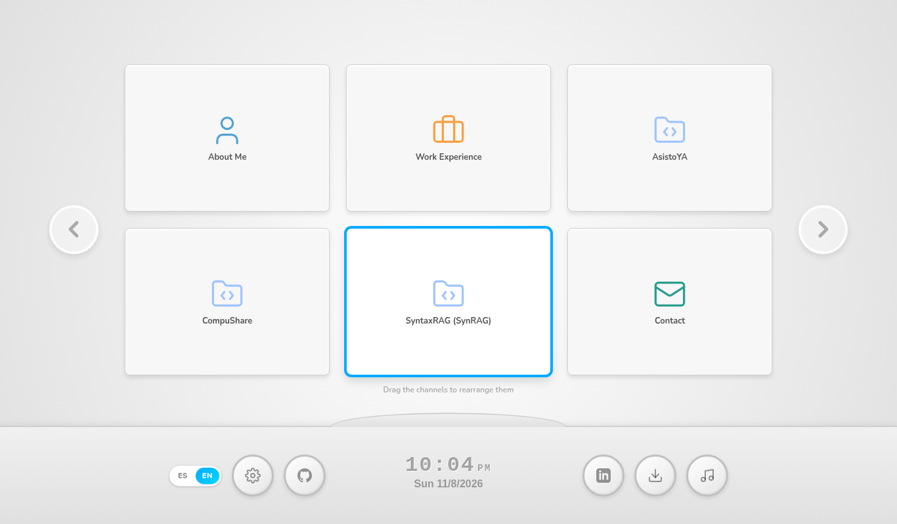

# Portfolio: Enmanuel Reynoso Salazar

Interactive personal portfolio inspired by the Nintendo Wii channel menu. Each
section is a channel on a grid, with a clock and optional background music, in
Spanish and English.

**Live:** https://enmanuel-portafolio.vercel.app

Español: [README.es.md](README.es.md)



## About the author

Full-stack software engineer. Founder and lead developer of
[AsistoYA](https://asistoya.com), a school attendance SaaS in production that
took 3rd place nationally at the MESCyT 2025 entrepreneurship competition. Also
publishes open-source tools for AI agents, and comes from hotel operations: PMS
(Cloudbeds, Hotello), night audit and booking engines.

## Stack

| Area | Technology |
| --- | --- |
| Framework | React 19, TypeScript, Vite 7 |
| Routing | React Router 7 |
| Styles | CSS custom properties (light and dark themes) |
| Icons | lucide-react |
| Audio | react-player |

There is no UI or styling library: the design system (surfaces, elevation,
gloss, radii) lives in CSS custom properties in `src/App.css`.

## Run locally

```bash
npm install
npm run dev      # development server
npm run build    # builds to dist/
npm run preview  # serves the build
npm run lint     # ESLint
```

Requires Node 20 or later.

## Structure

```
src/
├── components/
│   ├── layout/      PageShell, ChannelGrid, BottomBar, IntroScreen
│   └── ui/          ChannelTile, ToggleSwitch, VolumeSlider, ImageLightbox
├── context/         AudioContext, ThemeContext
├── data/
│   ├── portfolio.ts Spanish content (portfolio.en.ts is the English version)
│   ├── repositorios.ts Public repositories and where each one came from
│   └── channels.tsx Menu channels and their order
├── hooks/           useClock, useLocalStorage
├── pages/           One page per channel, plus the shared pages.css
└── types/           Domain types
```

### Where the content lives

All content lives in `src/data/portfolio.ts` (Spanish) and
`src/data/portfolio.en.ts` (English): experience, projects, education,
certifications, languages, recommendations and contact. Pages only render it,
so updating the portfolio usually means editing those two files.

**Keep both in parallel**: same number of entries and same order, so the content
does not change shape when the language changes.

Interface text (buttons, section titles, labels) is separate, in
`src/i18n/strings.ts`. If a key is missing in English, the project stops
compiling.

Certificate and letter scans go in `public/certificados/` and are referenced
from `portfolio.ts` with the `imagen` field.

CVs live in `cv/` as HTML and are published in `public/` as PDF:

| File | Use |
| --- | --- |
| `CV-Enmanuel-Reynoso-Automattic` | Software engineering. Also published as `CV-Enmanuel-Reynoso-Software-Engineer.pdf`, the one the portfolio links to. |
| `CV-Enmanuel-Reynoso` | General, focused on SaaS and technical support. |
| `CV-Enmanuel-Reynoso-Cloudbeds` | Focused on hotel technology and data. |

To regenerate a PDF, open the HTML in a browser and print to A4 PDF (margins are
already set with `@page`).

## Implementation notes

- **Languages:** ES/EN switch, saved in `localStorage`. The first visit follows
  the browser language. `<html lang>` and the clock format follow the active
  language.
- **Themes:** `data-theme` on `<html>`, with two blocks of custom properties in
  `src/App.css`. Components use no fixed colors.
- **Intro:** shown only on the home page and remembered per session
  (`sessionStorage`). A direct link goes straight to its section.
- **Animations:** the staggered card entrance uses `nth-child` in CSS, and
  everything is disabled under `prefers-reduced-motion`.

## License

Code available for reference. Personal content, images and certificates may not
be reused.
